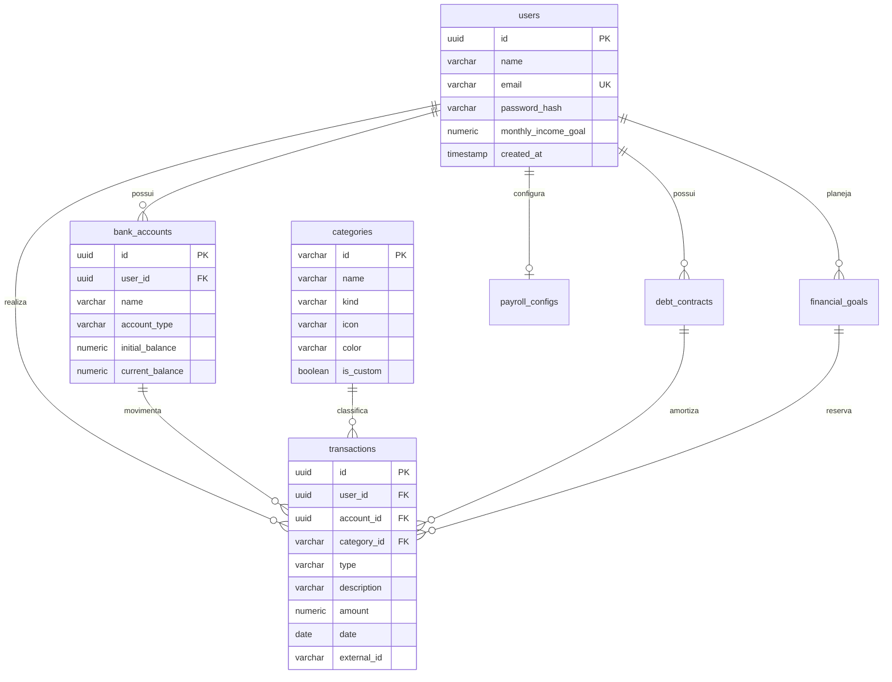

# FinPay Database & Cloud Architecture Guide 🐘☁️

Guia técnico e prático de arquitetura do banco de dados relacional **PostgreSQL**, cobrindo o ambiente local (**Docker**) e o ambiente de produção em nuvem (**Neon Serverless PostgreSQL** na AWS São Paulo `sa-east-1`), integração com **DBeaver**, modelo **Multi-Tenant** e rotas da **API Serverless**.

---

## 1. 🏗️ Ambientes Disponíveis

O **FinPay** suporta dois modos de conexão com o banco de dados:

| Recurso | Ambiente Local (Docker) | Ambiente Nuvem (Neon Cloud) |
| :--- | :--- | :--- |
| **Finalidade** | Desenvolvimento offline / Testes | Produção, PWA mobile e web |
| **Versão** | PostgreSQL 16 (Alpine) | PostgreSQL 18.6 (Neon Serverless) |
| **Região** | `localhost` | AWS São Paulo (`sa-east-1`) |
| **Persistência** | Volume Docker (`finpay_postgres_data`) | Storage Serverless com autoscaling |
| **SSL** | Desativado (local) | Obrigatório (`sslmode=require`) |
| **Isolamento** | Multi-tenant por `user_id` | Multi-tenant por `user_id` + JWT |

---

## 2. ☁️ Conexão de Produção (Neon Cloud no DBeaver)

Você pode conectar o DBeaver diretamente ao banco em nuvem sem precisar abrir o Docker:

1. Abra o **DBeaver**.
2. Clique em **Nova Conexão** ➔ **PostgreSQL**.
3. Na aba **Main**, preencha os dados (disponíveis no painel do seu projeto Neon ou nas variáveis de ambiente da Vercel):
   * **Host**: `<SEU_HOST_NEON>.neon.tech` (ex: `ep-xxxx.c-2.sa-east-1.aws.neon.tech`)
   * **Port**: `5432`
   * **Database**: `neondb`
   * **Username**: `<SEU_USUARIO_NEON>`
   * **Password**: `<SUA_SENHA_NEON>`
4. Na aba **SSL**:
   * Marque a caixa **Use SSL**.
   * Em **SSL mode**, selecione **require** (ou **verify-full**).
5. Clique em **Test Connection ...** ➔ Mensagem: **Connected!** ➔ **Finish**.

> 💡 **Formato da String de Conexão JDBC / URL:**
> ```text
> postgresql://<USUARIO>:<SENHA>@<HOST>:5432/neondb?sslmode=require
> ```
> *(Substitua pelos valores configurados nas variáveis de ambiente `POSTGRES_URL` da Vercel / Neon)*.

---

## 3. 🐳 Conexão Local com Docker (Opcional)

Para trabalhar totalmente desconectado da internet:

1. Abra o **Docker Desktop**.
2. No terminal do projeto, execute:
   ```powershell
   docker compose up -d
   ```
3. No **DBeaver**, crie uma conexão com:
   * **Host**: `localhost` | **Port**: `5432`
   * **Database**: `finpay_db`
   * **Username**: `finpay_admin`
   * **Password**: `finpay_secret_password`
   * **SSL**: Desmarcado
4. Para parar o container:
   ```powershell
   docker compose stop
   ```

---

## 4. 🔒 Modelo Multi-Tenant & Segurança Relacional

Cada usuário do FinPay possui seus registros 100% isolados:



### Regras de Integridade:
- **`user_id` em Todas as Tabelas**: Toda transação, conta, meta e contrato tem chave estrangeira apontando para `users(id)` com `ON DELETE CASCADE`.
- **Criptografia com Bcrypt**: Senhas são armazenadas como hash seguro (10 rounds de salt) no campo `password_hash`.
- **Tokens JWT**: Sessões autenticadas geram tokens assinados contendo `{ userId, email, name }` com validade de 30 dias.
- **Idempotência & Anti-Duplicidade**: O campo `external_id` armazena o identificador único da transação gerado no PWA. Ao sincronizar novamente, a query faz `UPDATE` se o registro já existir, evitando duplicar despesas.
- **Fallback Automático de Categorias**: 22 categorias padrão catalogadas. Se uma transação vier com categoria customizada inexistente, ela é automaticamente associada a `outros` sem lançar exceções relacionais.

---

## 5. 📡 Rotas da API Serverless (Vercel Functions)

As rotas backend rodam como serverless functions em Node.js (`api/*.ts`):

### 1. `GET /api/health`
Verifica a integridade do cluster PostgreSQL na nuvem.
* **Resposta 200**:
  ```json
  {
    "status": "online",
    "service": "FinPay PostgreSQL Neon Cloud API",
    "database": {
      "connected": true,
      "version": "PostgreSQL 18.6...",
      "totalTransactionsRecorded": 8
    }
  }
  ```

### 2. `POST /api/register`
Cria um novo usuário e inicializa suas contas padrão.
* **Payload**: `{ "name": "Nome", "email": "email@finpay.app", "password": "senha" }`
* **Retorno 201**: `{ "success": true, "token": "<JWT_TOKEN>", "user": { "id": "...", "name": "..." } }`

### 3. `POST /api/login`
Autentica o usuário validando a senha com bcrypt e devolve o JWT.
* **Payload**: `{ "email": "email@finpay.app", "password": "senha" }`
* **Retorno 200**: `{ "success": true, "token": "<JWT_TOKEN>", "user": { ... } }`

### 4. `POST /api/sync`
Sincroniza transações, contas e categorias do dispositivo móvel para o PostgreSQL.
* **Headers**: `Authorization: Bearer <JWT_TOKEN>` (ou anônimo/demo)
* **Payload**: `{ "protocol": "finpay_sync_v1", "accounts": [...], "transactions": [...] }`
* **Retorno 200**: `{ "success": true, "importedTransactions": 15, "syncedAt": "..." }`

### 5. `GET /api/overview`
Retorna extrato, contas, metas e dívidas isoladas do usuário autenticado.

---

## 6. 📊 Consultas SQL Analíticas Prontas para o DBeaver

Execute essas queries no editor SQL do DBeaver (**Ctrl + ]**):

### A. Extrato Consolidado por Usuário
```sql
SELECT 
    u.name AS usuario,
    COUNT(t.id) AS total_transacoes,
    SUM(CASE WHEN t.type = 'income' THEN t.amount ELSE 0 END) AS total_receitas,
    SUM(CASE WHEN t.type = 'expense' THEN t.amount ELSE 0 END) AS total_despesas,
    SUM(CASE WHEN t.type = 'income' THEN t.amount ELSE -t.amount END) AS saldo_liquido
FROM users u
LEFT JOIN transactions t ON t.user_id = u.id
GROUP BY u.id, u.name;
```

### B. Distribuição de Gastos por Categoria
```sql
SELECT 
    c.name AS categoria,
    COUNT(t.id) AS qtd,
    SUM(t.amount) AS total_gasto,
    ROUND((SUM(t.amount) / NULLIF((SELECT SUM(amount) FROM transactions WHERE type = 'expense'), 0)) * 100, 2) AS percentual
FROM transactions t
JOIN categories c ON c.id = t.category_id
WHERE t.type = 'expense'
GROUP BY c.name
ORDER BY total_gasto DESC;
```

### C. Raio-X de Contratos de Dívida e Juros
```sql
SELECT 
    name AS contrato,
    creditor AS instituicao,
    amortization_system AS sistema,
    current_balance AS saldo_devedor,
    monthly_payment AS valor_parcela,
    monthly_interest_rate AS taxa_am,
    ROUND(current_balance * (monthly_interest_rate / 100), 2) AS custo_juros_mes
FROM debt_contracts;
```
