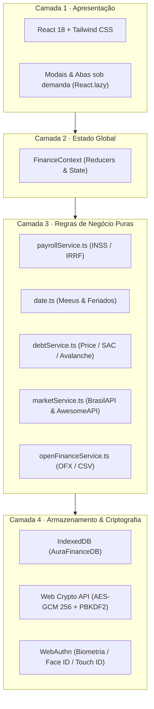

# FinPay — Sistema de Gestão Financeira Pessoal (Web & PWA)

> **FinPay** é um sistema Local-First de organização financeira diária, automação de folha CLT, controle de dívidas com simulador de amortização e análise de rendimentos em renda fixa. Desenvolvido para rodar 100% no navegador e ser instalado como PWA na tela inicial do celular (iPhone / Android) e desktop.

[](https://turbo-spruce-zzm9bal.vercel.app)
[](https://react.dev/)
[](https://www.typescriptlang.org/)
[](https://vitejs.dev/)
[](https://tailwindcss.com/)
[](https://vitest.dev/)

---

## 📱 Demonstração Online

Acesse diretamente pelo navegador do celular ou desktop:
👉 **[turbo-spruce-zzm9bal.vercel.app](https://turbo-spruce-zzm9bal.vercel.app)**

> *Não é necessário criar conta nem informar e-mail. Todos os dados são processados e armazenados no próprio dispositivo via IndexedDB.*

---

## ✨ Principais Funcionalidades

### 1. Automação de Folha CLT Recorrente
- **Cálculo Progressivo Oficial de INSS (2026)**: Faixa a faixa com alíquotas de 7,5% a 14% e deduções por faixa.
- **IRRF Retido na Fonte**: Comparação automática entre as deduções legais (dependentes + INSS) e o desconto simplificado oficial (R$ 607,44), aplicando o menor imposto.
- **Calendário Bancário Inteligente**: Identifica o **último dia útil** ou **5º dia útil** real de cada mês, recuando automaticamente finais de semana e feriados nacionais fixos e móveis (**Carnaval**, **Sexta-feira Santa**, **Páscoa** e **Corpus Christi** via Algoritmo de Meeus).
- **Ajustes Pontuais**: Lançamento de horas extras ou descontos pontuais exclusivos do mês sem alterar a configuração padrão dos meses seguintes.

### 2. Gestão de Dívidas & Simulador de Quitação Antecipada
- **Raio-X de Contratos**: Separação precisa de quanto de cada parcela abate o saldo devedor (amortização do principal) e quanto custa em juros reais nos sistemas **Price** (prestação constante) e **SAC** (amortização constante).
- **Simulador Estratégico**: Compara o impacto de aportes extras mensais em dois métodos clássicos:
  - **Método Avalanche**: Prioriza a maior taxa de juros (maximiza a economia financeira em reais).
  - **Método Bola de Neve**: Prioriza o menor saldo devedor (elimina contratos mais rápido para alívio psicológico).

### 3. Importação Local de Extratos (.OFX e .CSV)
- **Parser 100% no Cliente**: Importa arquivos de extrato bancário padrão `.ofx` ou `.csv` diretamente no navegador.
- **Anti-Duplicidade**: Utiliza o identificador único da transação bancária (`FITID`) para impedir que lançamentos repetidos entrem no extrato.
- **Auto-Categorização**: Reconhece termos frequentes (iFood, Uber, Supermercado, etc.) e classifica os lançamentos automaticamente.

### 4. Metas Financeiras & Mercado ao Vivo
- **Boletim Diário BCB**: Integração com a **BrasilAPI** e **AwesomeAPI** para consulta das taxas da **Selic**, **CDI**, **IPCA** e **Dólar Comercial**.
- **Simulador de Renda Fixa Líquida**: Compara o rendimento mensal e anual líquido de qualquer valor aplicado em:
  - Tesouro Selic / CDB 100% CDI (com alíquota regressiva de IR)
  - LCI / LCA Isenta de IR (92% do CDI)
  - Poupança Tradicional
- **Projeção de Metas**: Cálculo de aporte mensal necessário e de rendimento passivo gerado pelo saldo já acumulado.

---

## 🏛️ Arquitetura de Software (Local-First)



1. **Privacidade Absoluta**: Nenhuma informação financeira é enviada para servidores externos.
2. **Persistência Híbrida**: O estado principal vive no **IndexedDB** com espelhamento síncrono para garantir abertura instantânea em 0ms.
3. **Criptografia de Backups**: A exportação do cofre é protegida com **AES-GCM de 256 bits** derivado via **PBKDF2** com 100.000 iterações.
4. **Performance Mobile**: Code-splitting com `React.lazy` mantém o bundle inicial em **73 KB (gzip)**.

---

## 🧪 Testes Automatizados

O núcleo financeiro possui cobertura de testes unitários com **Vitest**:

```bash
npm test
```

Os testes cobrem:
- Faixas progressivas oficiais de INSS e cálculo do teto.
- Dedução legal de IRRF vs. desconto simplificado.
- Cálculo de Páscoa, Carnaval, Sexta-feira Santa e Corpus Christi.
- Recuo do último dia útil bancário.
- Amortização Price e SAC.
- Criptografia e descriptografia AES-GCM 256 com PBKDF2.
- Anti-duplicidade de transações por FITID.

---

## 🚀 Como Executar Localmente

### Pré-requisitos
- Node.js 18+ instalado
- npm ou yarn

### Instalação e Execução
```bash
# 1. Clone o repositório
git clone https://github.com/Henrique06Paiva/finpay-web.git
cd finpay-web

# 2. Instale as dependências
npm install

# 3. Inicie o servidor de desenvolvimento
npm run dev

# 4. Gere o build de produção
npm run build
```

---

## 👤 Autor

Desenvolvido por **Henrique Paiva**  
- LinkedIn: [Henrique Esteves de Paiva](https://linkedin.com/in/henrique-paiva)  
- GitHub: [@Henrique06Paiva](https://github.com/Henrique06Paiva)
