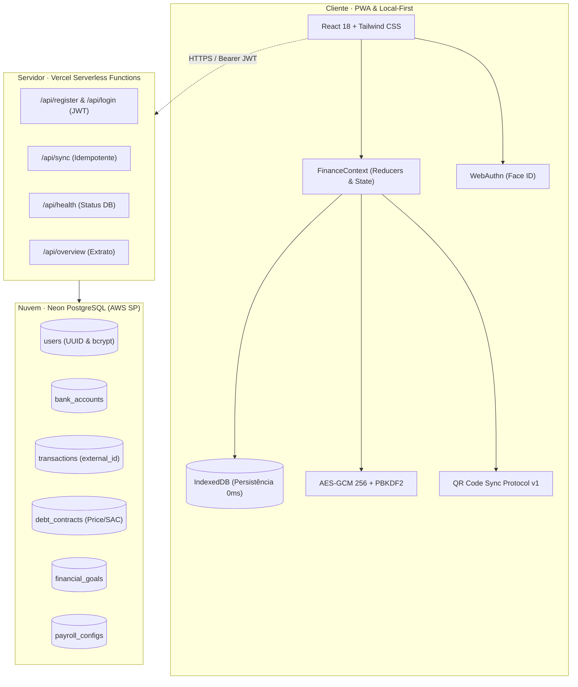

# FinPay — Sistema de Gestão Financeira Pessoal (Web, PWA & Cloud)

> **FinPay** é um ecossistema financeiro híbrido (**Local-First + Nuvem PostgreSQL**) desenvolvido com React 18, TypeScript e Tailwind CSS. Combina a velocidade e privacidade do armazenamento local no dispositivo com a flexibilidade da sincronização em nuvem multi-dispositivo (**PostgreSQL Serverless Neon na AWS São Paulo**) e transferência offline via QR Code.

[](https://turbo-spruce-zzm9bal.vercel.app)
[](https://neon.tech)
[](https://react.dev/)
[](https://www.typescriptlang.org/)
[](https://vitejs.dev/)
[](https://tailwindcss.com/)
[](https://vitest.dev/)

---

## 📱 Aplicação em Produção

Acesse diretamente pelo navegador do celular ou desktop:  
👉 **[https://turbo-spruce-zzm9bal.vercel.app](https://turbo-spruce-zzm9bal.vercel.app)**

> 🔒 **Híbrido e Privado**: O app funciona 100% offline via **IndexedDB** sem exigir cadastro imediato. Quando desejar backup na nuvem ou acessar em múltiplos dispositivos, basta criar sua conta com 1 clique para conectar ao **PostgreSQL Neon** com isolamento total dos seus dados.

---

## ✨ Principais Funcionalidades

### 1. Nuvem PostgreSQL Serverless & Multi-Tenancy
- **PostgreSQL 18.6 na AWS SP (`sa-east-1`)**: Banco de dados relacional hospedado na nuvem via Neon com pooler de conexões e baixa latência.
- **Isolamento por Usuário (Multi-Tenant)**: Cada conta possui um `UUID` único; todas as tabelas (`transactions`, `bank_accounts`, `debt_contracts`, `financial_goals`) são estritamente isoladas por `user_id` com integridade referencial em cascata.
- **Autenticação Segura**: Senhas com hash `bcrypt` (10 rounds de salt) e sessões sem estado validadas via **JWT (JSON Web Token)** de 30 dias.
- **Compatibilidade DBeaver**: Banco relacional pronto para análise de dados, geração de diagramas ER e dashboards SQL. Consulte o [DATABASE_GUIDE.md](file:///c:/Users/Henrique%20Paiva/Documents/antigravity/dazzling-hypatia/DATABASE_GUIDE.md).

### 2. Sincronização Cruzada Offline (QR Code Interoperável)
- **Protocolo `finpay_sync_v1`**: Transfira o estado financeiro completo entre iPhone (iOS PWA) e terminais Android / PAX A910 sem depender de cabos ou conexão com a internet.
- **Compactação de Payload**: Formato enxuto com até 30 transações recentes, saldos, metas e contratos de dívida em um único QR Code escaneável.

### 3. Automação de Folha CLT Recorrente (Regulamentação Oficial 2026)
- **Cálculo Progressivo Oficial de INSS**: Cálculo faixa a faixa com alíquotas de 7,5% a 14% e parcelas a deduzir oficiais.
- **IRRF Retido na Fonte**: Comparação automática entre a dedução legal (dependentes + INSS) e o desconto simplificado oficial (R$ 607,44), aplicando o menor imposto para o trabalhador.
- **Calendário Bancário Inteligente**: Identifica o **último dia útil** ou **5º dia útil** real de cada mês, recuando automaticamente finais de semana e feriados nacionais fixos e móveis (**Carnaval**, **Sexta-feira Santa**, **Páscoa** e **Corpus Christi** calculados via Algoritmo Astronômico de Meeus).
- **Ajustes Pontuais**: Lançamento de horas extras ou descontos pontuais exclusivos do mês sem alterar a configuração padrão dos meses seguintes.

### 4. Gestão de Dívidas & Simulador de Quitação Estratégica
- **Raio-X de Contratos (Price vs. SAC)**: Decomposição matemática precisa entre amortização do principal e custo de juros reais de cada parcela.
- **Simulador Estratégico com Aportes Extras**:
  - **Método Avalanche**: Prioriza quitar dívidas com maior taxa de juros (maximiza a economia financeira em reais).
  - **Método Bola de Neve**: Prioriza contratos de menor saldo devedor (elimina contratos mais rápido para alívio psicológico).

### 5. Open Finance Local (.OFX e .CSV)
- **Parser 100% no Cliente**: Importa arquivos de extrato bancário padrão `.ofx` ou `.csv` diretamente no navegador sem enviar arquivos para a internet.
- **Anti-Duplicidade por FITID**: Utiliza o identificador bancário único da transação para impedir que lançamentos repetidos entrem no extrato.
- **Auto-Categorização Inteligente**: Reconhece padrões recorrentes (iFood, Uber, Supermercado, etc.) e classifica os lançamentos automaticamente.

### 6. Cotações de Mercado em Tempo Real & Renda Fixa
- **Boletim Diário BCB**: Integração com a **BrasilAPI** e **AwesomeAPI** para cotações em tempo real da taxa **Selic**, **CDI**, **IPCA** e **Dólar Comercial**.
- **Simulador de Renda Fixa Líquida**: Comparativo com desconto de imposto de renda regressivo entre Tesouro Selic / CDB 100% CDI, LCI/LCA isenta e Poupança.

### 7. Segurança Nativa do iOS
- **WebAuthn Biométrico**: Desbloqueio com **Face ID** e **Touch ID** nativo no Safari/iOS.
- **PIN Numérico de 4 Dígitos**: Proteção por senha com hash SHA-256 no armazenamento local.
- **Atalhos da Siri & Webhooks**: Automação via app Atalhos do iOS para registrar gastos por voz.

---

## 🏛️ Arquitetura de Software



---

## 🧪 Testes Automatizados

O ecossistema conta com suíte de testes unitários executados via **Vitest**:

```bash
npm test
```

A cobertura inclui:
- Faixas progressivas oficiais de INSS e teto previdenciário.
- Dedução legal de IRRF vs. desconto simplificado.
- Algoritmo de Meeus (Páscoa, Carnaval, Sexta-feira Santa, Corpus Christi).
- Recuo do último dia útil bancário.
- Amortização Price e SAC.
- Criptografia e descriptografia AES-GCM 256 com PBKDF2.
- Anti-duplicidade e conciliação bancária por FITID.
- Sincronização interoperável de payloads e validação de atalhos.

---

## 🚀 Como Executar Localmente

### Pré-requisitos
- Node.js 18+ instalado
- npm ou yarn
- (Opcional) Docker Desktop para rodar PostgreSQL local

### Instalação e Execução
```bash
# 1. Clone o repositório
git clone https://github.com/Henrique06Paiva/finpay-web.git
cd finpay-web

# 2. Instale as dependências
npm install

# 3. Inicie o servidor de desenvolvimento Vite
npm run dev

# 4. (Opcional) Suba o PostgreSQL local via Docker
docker compose up -d

# 5. Gere o build de produção
npm run build
```

---

## 📚 Documentação Técnica Adicional

- [DATABASE_GUIDE.md](file:///c:/Users/Henrique%20Paiva/Documents/antigravity/dazzling-hypatia/DATABASE_GUIDE.md): Guia completo de configuração do banco PostgreSQL no Neon e Docker, tabelas, consultas analíticas e conexão com o DBeaver.

---

## 👤 Autor

Desenvolvido por **Henrique Paiva**  
- LinkedIn: [Henrique Esteves de Paiva](https://linkedin.com/in/henrique-paiva)  
- GitHub: [@Henrique06Paiva](https://github.com/Henrique06Paiva)
